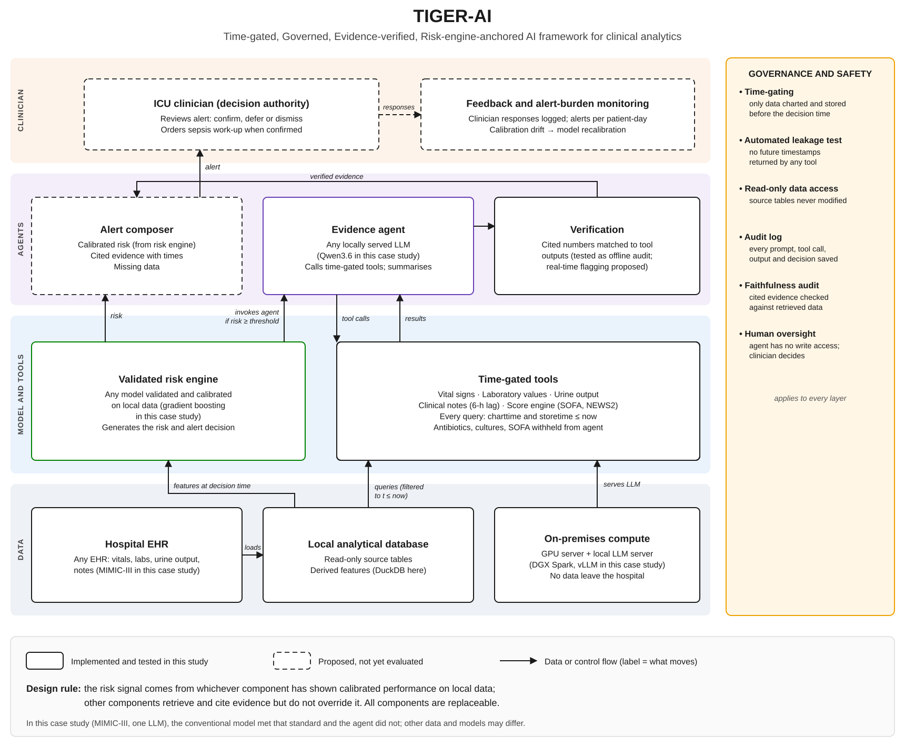
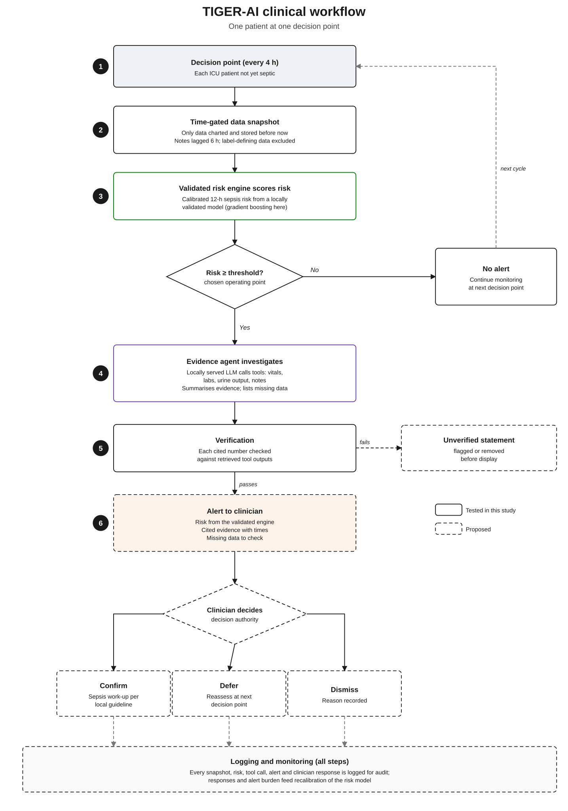

# timegated-llm-sepsis-agent

Code for:

> Saxena A, Sinha RK. **TIGER-AI: a human-supervised agentic AI framework for clinical analytics—on-premises implementation and an ICU sepsis case study.** *Manuscript submitted.* [Add journal, year and DOI when available.]

The paper proposes **TIGER-AI** (Time-gated, Governed, Evidence-verified, Risk-engine-anchored AI), a layered framework for using AI agents in hospital clinical analytics. A validated risk engine produces the patient's risk, a locally served LLM agent finds and explains the supporting evidence, a verification step checks what the agent cites, and the clinician makes the decision. A governance layer runs across all of it: time-gating, automated leakage testing, read-only data access, audit logging and human oversight.

*Fig. 1. TIGER-AI architecture. Solid boxes were implemented and tested in the case study; dashed boxes are proposed.*

*Fig. 2. TIGER-AI clinical workflow for one patient at one decision point.*

This repository contains the implementation used for the paper's case study: 12-hour early warning of ICU-onset Sepsis-3 in MIMIC-III. **It contains no MIMIC-III data, derived data or outputs.**

---

## TIGER-AI components and where they are in the code

| Framework layer | Component | Notebook part |
|---|---|---|
| Data | Cohort, hourly SOFA, Sepsis-3 labels and decision points from MIMIC-III in a local DuckDB database (source tables read-only) | Parts 0–5 |
| Models and tools | Time-gated tools (vital signs, laboratory values, urine output, clinical notes with a 6-h lag) | Part 6 |
| Models and tools | Risk engine: tuned, Platt-calibrated gradient boosting on time-gated features | Part 12 |
| Agents | Evidence agent: ReAct-style tool-calling loop with a local open-weight LLM served by vLLM | Parts 7–8 |
| Agents | Agent with the engine's risk available as a tool | Part 14 |
| Governance | Automated leakage test (no tool may return data recorded after the decision time; Algorithm 1 in the paper) | Part 6 (and Parts 11, 14 for added tools) |
| Governance | Faithfulness check: numbers cited by the agent matched against tool outputs | Part 9 |
| Evaluation | Discrimination at the true prevalence, calibration, alert burden, decision curves | Parts 9, 12 |

The risk engine and the LLM are replaceable. Any locally validated model can fill the risk-engine slot, and any locally served LLM with tool calling can fill the agent slot.

## What produces the paper's results

- **Main case-study results** (governance checks; agent on its own vs risk engine vs agent with engine risk): Parts 0–9, 12 and 14.
- **Additional analyses** summarised in the paper (ablations, repeated runs, alternative outcome definitions, temporal and care-unit validation): Parts 11, 13, 14 and 15.

## Repository contents

| File | Description |
|---|---|
| `sepsis_agent_mimic3_code_availability.ipynb` | Complete analysis in 18 commented code cells, outputs cleared |
| `figures/` | Framework architecture and clinical workflow diagrams (SVG) |
| `README.md` | This file |
| `requirements.txt` | Python packages |
| `LICENSE` | MIT license (code only) |
| `.gitignore` | Keeps data and outputs out of the repository |

## Data access

MIMIC-III v1.4 is restricted. To run the code you need to:

1. Complete the required training and become a credentialed user on [PhysioNet](https://physionet.org/).
2. Sign the data use agreement for [MIMIC-III v1.4](https://physionet.org/content/mimiciii/1.4/).
3. Load the MIMIC-III tables into a local DuckDB file with the standard lower-case table names.

> **Data use agreement.** Files the notebook writes to `OUT_DIR` (agent traces, evaluation samples, feature tables) contain patient-level information. Do not commit them to any public repository, and share them only with credentialed PhysioNet users. All LLM inference runs on a local server; no patient data are sent to external services.

## Requirements

- Python 3.12; install packages with `pip install -r requirements.txt`
- A vLLM server with tool calling, needed only for Parts 7–8, 11 and 14. The case study used `nvidia/Qwen3.6-35B-A3B-NVFP4` on vLLM 0.21.0 (development build, commit 2325b6f0) at `http://localhost:8001/v1`.
- Hardware used: one NVIDIA DGX Spark (128 GB unified memory). DuckDB was limited to 28 GB so it could share memory with vLLM.

Settings such as `DB_PATH`, `OUT_DIR`, `VLLM_URL` and `MODEL` are at the top of Part 0.

## Running

Run the cells from top to bottom. LLM runs are resumable: results are appended to JSONL files, and re-running a cell continues where it stopped. All agent runs together made about 8,300 LLM calls (roughly 28 h at a concurrency of 8).

## Reproducibility notes

- Reasoning mode used temperature 0.6, top-p 0.95 and top-k 20, with a per-step seed of 42 + step.
- The evaluation sample is frozen in `eval_points.csv` on the first run, so every configuration is scored on the same decision points.
- LLM outputs vary between runs even with fixed seeds; Part 14 measures this with repeated runs.
- Run the leakage test whenever a tool is added or changed.

## Citation

If you use this code, please cite the article above. [Add BibTeX once published.]

## License

MIT (see `LICENSE`). The license covers the code only. MIMIC-III remains governed by the PhysioNet Credentialed Health Data License and data use agreement.

## Contact

Aditya Saxena and Rajesh Kumar Sinha, School of Digital Health, IIHMR University, Jaipur, India
